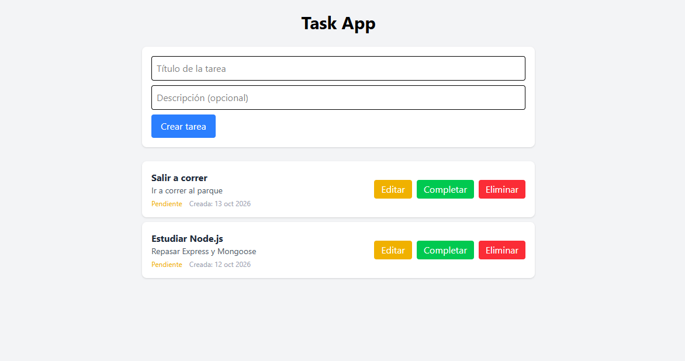

# task-front
Aplicación web para la gestión de tareas, desarrollada con React y Vite. Implementa un CRUD completo consumiendo una API RESTful. Utiliza Tailwind CSS para el diseño y Axios para las peticiones HTTP. Interfaz intuitiva con estados de carga y manejo de errores.

## Capturas


---
## 🛠️ Tecnologías

| Tecnología | Descripción |
| :--- | :--- |
| **React** | Librería de UI |
| **Vite** | Empaquetador |
| **Tailwind CSS** | Estilos |
| **Axios** | Peticiones HTTP |

---

## Instalación
```bash
npm install
```
## Ejecutar
```bash
npm run dev
```

## Variables de entorno
Crea un archivo `.env` en la raíz del proyecto con:
VITE_API_URL= `https://task-api-qt09.onrender.com/api/tareas`